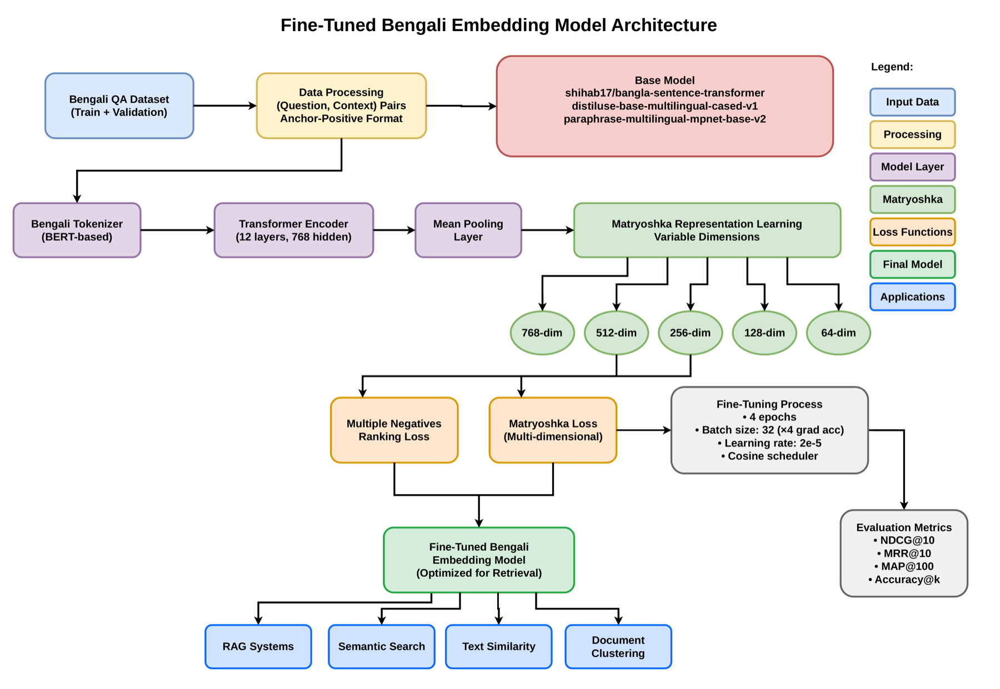
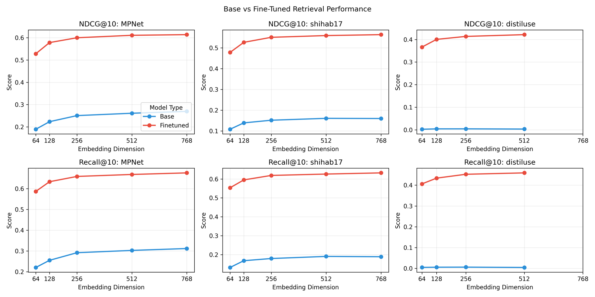

<div align="center">

# Optimizing Semantic Retrieval for Bengali

### A Comparative Analysis of Monolingual and Multilingual Embeddings with Matryoshka Representation Learning

**[Koshik Debanath](https://orcid.org/0009-0005-7026-3003)** · **[Azmain Yakin Srizon](https://orcid.org/0000-0003-4674-0365)**

Department of Computer Science and Engineering, Rajshahi University of Engineering and Technology (RUET), Bangladesh

*ACM Transactions on Asian and Low-Resource Language Information Processing (TALLIP), accepted 2026*

[](https://kowshik24.github.io/Bangla-Embedding/)
[](https://huggingface.co/Kowshik24)
[](https://huggingface.co/datasets/sartajekram/BanglaRQA)
[](https://dl.acm.org/journal/tallip)



</div>

---

## Abstract

Effective semantic retrieval remains the primary bottleneck for Bengali Retrieval-Augmented Generation (RAG) systems. While general-purpose multilingual models exist, they often lack the semantic alignment required for high-precision tasks. We compare three embedding architectures: monolingual (`shihab17`), distilled multilingual (`distiluse`), and paraphrase-focused (`mpnet`). Each is fine-tuned on **BanglaRQA** with **Multiple Negatives Ranking Loss** wrapped in **Matryoshka Representation Learning (MRL)**.

On 1,124 answerable BanglaRQA test queries, fine-tuned MPNet reaches **NDCG@10 = 0.6139**, the best dense result, and beats the monolingual baseline with statistical significance (p < 0.001). A BM25 lexical baseline is also strong here (**0.9142**). That result shows dense fine-tuning matters most when you need semantic matching, compression, and RAG integration; it does not replace lexical retrieval everywhere. The MRL-trained MPNet keeps **96.1%** of its 768d effectiveness at **128 dimensions**, which cuts vector storage by **83.3%**.

## Highlights

| | |
|---|---|
| **+127%** | NDCG@10 gain for MPNet after fine-tuning (0.2695 → 0.6139) |
| **96.1%** | Retrieval quality retained at 128d vs. 768d |
| **83.3%** | Vector-index storage reduction (3.29 MB → 0.55 MB) |
| **p < 0.001** | MPNet-FT vs. Shihab17-FT, Wilcoxon signed-rank on per-query NDCG@10 |

**Contributions**

1. **Controlled architecture benchmark.** Monolingual, distilled-multilingual and paraphrase-multilingual encoders go through one identical fine-tuning recipe, so differences come from architectural priors.
2. **Matryoshka efficiency study.** Saturation, retention, storage-cost and an MNRL-only ablation show that MRL keeps low-dimensional prefixes useful.
3. **Downstream RAG evaluation.** A RAGAS check with a fixed FAISS + GPT-3.5 pipeline, plus bilingual qualitative and error analysis.
4. **Honest baselines.** BM25 is reported next to the dense models, which motivates hybrid dense–lexical retrieval for Bengali factoid QA.

## Method

| Base model | Type | Dim |
|---|---|---|
| [`shihab17/bangla-sentence-transformer`](https://huggingface.co/shihab17/bangla-sentence-transformer) | Monolingual (XLM-R, knowledge-distilled) | 768 |
| [`distiluse-base-multilingual-cased-v1`](https://huggingface.co/sentence-transformers/distiluse-base-multilingual-cased-v1) | Distilled multilingual USE | 512 |
| [`paraphrase-multilingual-mpnet-base-v2`](https://huggingface.co/sentence-transformers/paraphrase-multilingual-mpnet-base-v2) | Paraphrase multilingual MPNet | 768 |

All three models use a Siamese bi-encoder with mean pooling. The objective is `MatryoshkaLoss(MultipleNegativesRankingLoss)` at nested dimensions **{768, 512, 256, 128, 64}**:

$$
\min_{\theta}\; \frac{1}{N}\sum_{i=1}^{N}\sum_{m\in M} c_m\,\mathcal{L}_{\text{MNRL}}\big(F(x_i;\theta)_{1:m},\, y_i\big)
$$

**Data.** BanglaRQA (Bengali Wikipedia QA), filtered to `is_answerable=1`. Train + validation give 10,134 positive pairs; 1,124 held-out test queries are used for evaluation.

## Results

### Retrieval (Regime A: 1,124 queries, 11,258 candidate passages)

| Model | Dim | NDCG@10 | MRR@10 | MAP@100 | Acc@10 | P@10 | R@10 |
|---|:-:|:-:|:-:|:-:|:-:|:-:|:-:|
| DistilUSE (base) | 512 | 0.0037 | 0.0036 | 0.0056 | 0.0044 | 0.0014 | 0.0040 |
| DistilUSE-FT | 512 | 0.4213 | 0.3955 | 0.4248 | 0.4698 | 0.1770 | 0.4592 |
| Shihab17 (base) | 768 | 0.1599 | 0.1411 | 0.1651 | 0.1993 | 0.0715 | 0.1889 |
| Shihab17-FT | 768 | 0.5638 | 0.5179 | 0.5586 | 0.6557 | 0.2424 | 0.6323 |
| MPNet (base) | 768 | 0.2695 | 0.2413 | 0.2761 | 0.3283 | 0.1201 | 0.3120 |
| **MPNet-FT** † | 768 | **0.6139** | **0.5712** | **0.6094** | **0.6913** | **0.2593** | **0.6762** |
| *BM25 (lexical)* | – | *0.9142* | *0.8910* | *0.9053* | *0.9537* | *0.3631* | *0.9476* |

† Best dense model. Wilcoxon signed-rank vs. Shihab17-FT: p = 7.81×10⁻⁶; vs. DistilUSE-FT: p = 1.00×10⁻⁴⁷.

<p align="center"></p>

### MNRL-only ablation

| Model | Objective | Full NDCG@10 | 128d NDCG@10 | 128d Ret. | 64d Ret. |
|---|---|:-:|:-:|:-:|:-:|
| MPNet | MNRL + MRL | 0.6139 | 0.5783 | **94.2%** | **86.0%** |
| MPNet | MNRL only | 0.6340 | 0.5684 | 89.7% | 77.7% |
| Shihab17 | MNRL + MRL | 0.5638 | 0.5268 | **93.4%** | **84.8%** |
| Shihab17 | MNRL only | 0.5784 | 0.5356 | 92.6% | 79.5% |
| DistilUSE | MNRL + MRL | 0.4213 | 0.4004 | **95.0%** | **86.9%** |
| DistilUSE | MNRL only | 0.4526 | 0.4072 | 90.0% | 71.6% |

MRL gives up a little full-dimension score in exchange for much better quality after truncation.

### Storage vs. accuracy (Regime B: 1,124-document index)

| Config | Dim | Index size | NDCG@10 | Retention |
|---|:-:|:-:|:-:|:-:|
| MPNet-Base | 768 | 3.29 MB | 0.4715 | – |
| MPNet-FT | 768 | 3.29 MB | 0.8114 | 100.0% |
| MPNet-FT | 512 | 2.20 MB | 0.8072 | 99.5% |
| MPNet-FT | 256 | 1.10 MB | 0.7918 | 97.6% |
| **MPNet-FT** | **128** | **0.55 MB** | **0.7796** | **96.1%** |
| MPNet-FT | 64 | 0.27 MB | 0.7438 | 91.7% |

### Downstream RAG (RAGAS, 10 Bengali factual queries, mean ± 95% CI)

| Retriever | Context Precision | Context Recall | Faithfulness | Answer Relevancy |
|---|:-:|:-:|:-:|:-:|
| **MPNet-FT** | **0.750 ± 0.263** | **0.900 ± 0.196** | **0.700 ± 0.299** | **0.421 ± 0.276** |
| Shihab17-FT | 0.650 ± 0.294 | 0.800 ± 0.261 | 0.600 ± 0.320 | 0.249 ± 0.250 |
| DistilUSE-FT | 0.450 ± 0.308 | 0.600 ± 0.320 | 0.500 ± 0.327 | 0.264 ± 0.264 |

More figures (saturation curves, MTEB transfer, error analysis) are on the **[project page](https://kowshik24.github.io/Bangla-Embedding/)**.

## Released Models

| Model | Hugging Face |
|---|---|
| **MPNet-FT** (recommended) | [`Kowshik24/bangla-sentence-transformer-ft-matryoshka-paraphrase-multilingual-mpnet-base-v2`](https://huggingface.co/Kowshik24/bangla-sentence-transformer-ft-matryoshka-paraphrase-multilingual-mpnet-base-v2) |
| Shihab17-FT | [`Kowshik24/bangla-sentence-transformer-ft-matryoshka`](https://huggingface.co/Kowshik24/bangla-sentence-transformer-ft-matryoshka) |
| DistilUSE-FT | [`Kowshik24/bangla-sentence-transformer-ft-matryoshka-distiluse-base-multilingual-cased-v1`](https://huggingface.co/Kowshik24/bangla-sentence-transformer-ft-matryoshka-distiluse-base-multilingual-cased-v1) |

### Quick start

```python
from sentence_transformers import SentenceTransformer

model = SentenceTransformer(
    "Kowshik24/bangla-sentence-transformer-ft-matryoshka-paraphrase-multilingual-mpnet-base-v2",
    truncate_dim=128,  # Matryoshka: 128d keeps ~96% of 768d quality
)

query = "বিশ্বের প্রথম কম্পিউটার কে তৈরি করেন?"
passages = [
    "চার্লস ব্যাবেজ ১৮৩৭ সালে অ্যানালিটিক্যাল ইঞ্জিনের নকশা করেন।",
    "রায়পুর ছত্তীসগঢ় রাজ্যের রাজধানী।",
]
q = model.encode(query, normalize_embeddings=True)
p = model.encode(passages, normalize_embeddings=True)
print(model.similarity(q, p))
```

## Reproducing the Experiments

### Setup

```bash
git clone https://github.com/kowshik24/Bangla-Embedding.git
cd Bangla-Embedding
uv sync                      # or: pip install -r requirements.txt
cp .env.example .env         # add HF_TOKEN to push models to the Hub
```

### Main pipeline (`src/main.py`)

```bash
# 1. Fine-tune with MNRL + Matryoshka loss
python src/main.py --mode train \
    --model_id "sentence-transformers/paraphrase-multilingual-mpnet-base-v2" \
    --output_dir output/mpnet-ft \
    --hub_model_id your-username/bangla-mpnet-ft     # optional

# 2. MTEB Bengali tasks
python src/main.py --mode mteb --model_id output/mpnet-ft --output_dir results/mteb

# 3. Wilcoxon signed-rank significance test
python src/main.py --mode stats --model_id output/mpnet-ft --output_dir results/stats

# 4. Storage vs. performance analysis
python src/main.py --mode efficiency --model_id output/mpnet-ft --output_dir results/efficiency
```

Data paths default to `BanglaRQA/{Train,Validation,Test}.json`. Override them with `--train_path`, `--val_path` and `--test_path`; a copy of the public splits is in `paper/v2/data/BanglaRQA/`.

### Revision experiments (BM25, MNRL-only ablation, RAGAS)

```bash
uv run python paper/v2/scripts/run_bm25_baseline.py \
  --train paper/v2/data/BanglaRQA/Train.json \
  --validation paper/v2/data/BanglaRQA/Validation.json \
  --test paper/v2/data/BanglaRQA/Test.json \
  --output paper/v2/results/bm25_results.csv

uv run python paper/v2/scripts/run_mnrl_ablation.py \
  --train paper/v2/data/BanglaRQA/Train.json \
  --validation paper/v2/data/BanglaRQA/Validation.json \
  --test paper/v2/data/BanglaRQA/Test.json \
  --model-map paper/v2/config/model_map.json \
  --output-dir paper/v2/ablation_models \
  --results-dir paper/v2/results \
  --device cuda

uv run --extra rag python paper/v2/scripts/run_ragas_eval.py --help
```

### Hyperparameters

| Parameter | Value |
|---|---|
| Batch size (per device) × grad. accumulation | 32 × 4 = 128 |
| Epochs | 4 |
| Learning rate / scheduler / warmup | 2e-5 / cosine / 10% |
| Optimizer | AdamW (fused) |
| Max sequence length | 512 |
| Matryoshka dims | {768, 512, 256, 128, 64} |
| Precision | FP32 |
| Hardware | 1× NVIDIA T4 16 GB (~45 min for MPNet) |

## Repository Structure

```text
├── src/                    # Modular pipeline
│   ├── data/               #   BanglaRQA loading and splitting
│   ├── models/             #   Matryoshka + MNRL trainer, model utils
│   ├── evaluation/         #   IR evaluator, MTEB runner
│   ├── analysis/           #   Wilcoxon stats, efficiency, plots
│   └── main.py             #   CLI entry point
├── notebook/               # Original Colab notebooks (training, MTEB, RAGAS, stats)
├── results/                # CSV results from the main experiments
├── figures/ , diagram/     # Paper figures and draw.io sources
├── paper/                  # Manuscript versions (v1 → v4) and revision scripts
└── docs/                   # GitHub Pages project site
```

## Limitations

- Training and evaluation use only BanglaRQA (factoid Wikipedia QA). Conversational, reasoning and domain-specific (medical, legal) Bengali are not tested.
- BM25 is very strong on this benchmark. Read the dense results as a case for hybrid dense–lexical systems, not a replacement for lexical retrieval.
- At 64d, negation and complex morphological compounds degrade. Use **128d as the minimum**.
- The RAGAS check uses 10 queries and has wide confidence intervals, so treat it as suggestive.

## Citation

```bibtex
@article{debanath2026optimizing,
  title   = {Optimizing Semantic Retrieval for Bengali: A Comparative Analysis of
             Monolingual and Multilingual Embeddings with Matryoshka
             Representation Learning},
  author  = {Debanath, Koshik and Srizon, Azmain Yakin},
  journal = {ACM Transactions on Asian and Low-Resource Language Information Processing},
  year    = {2026},
  note    = {Accepted}
}
```

## Acknowledgments

We thank the open-source model creators, the [sentence-transformers](https://www.sbert.net/) project, and the [BanglaRQA](https://huggingface.co/datasets/sartajekram/BanglaRQA) dataset curators.
